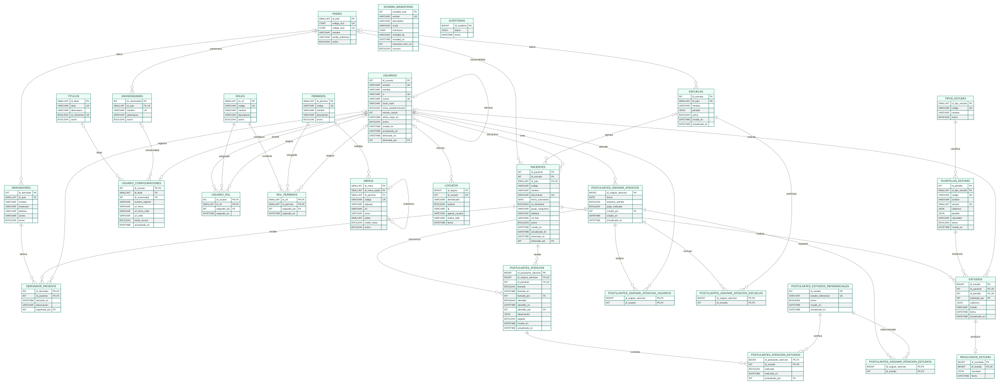

# DER — Salus Infirmorum

El diagrama representa el esquema resultante de las migraciones `V1` a `V10`,
más la tabla técnica `schema_migrations` creada por el ejecutor.

- `PK`: clave primaria.
- `FK`: clave foránea.
- `UK`: columna que forma parte de una restricción única.
- `auditorias` no tiene una FK directa porque actor, entidad y registro se
  almacenan dentro de `datos` en formato JSON.
- `postulantes_atencion.observacion` guarda tres hilos de conversación en JSON:
  `clinica`, `general` y `doctor`.
- Las tablas puente de asignación permiten varios profesionales, escuelas y
  estudios por cabecera sin duplicar la jornada.

La fuente regenerable del gráfico está en [`DER.mmd`](DER.mmd).
